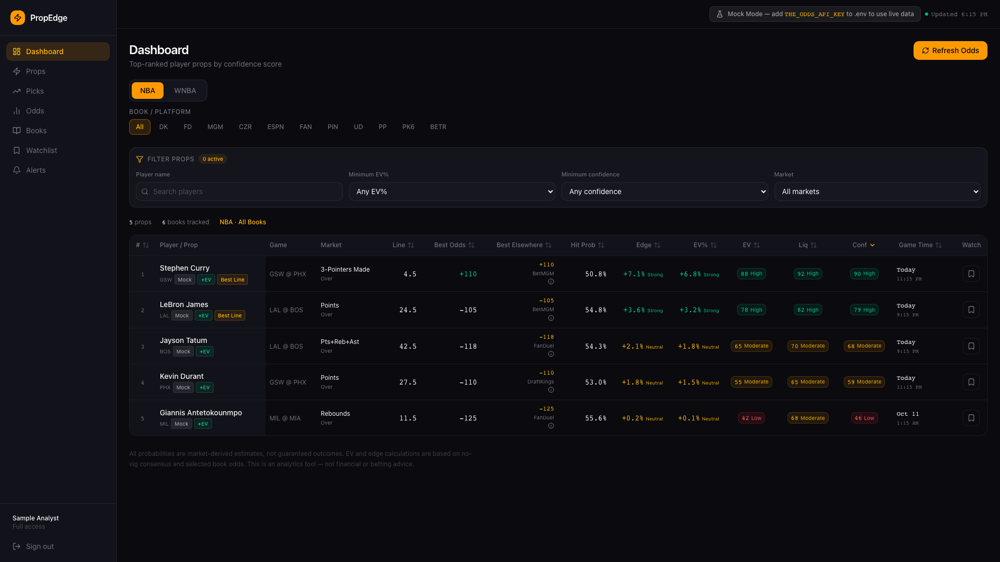
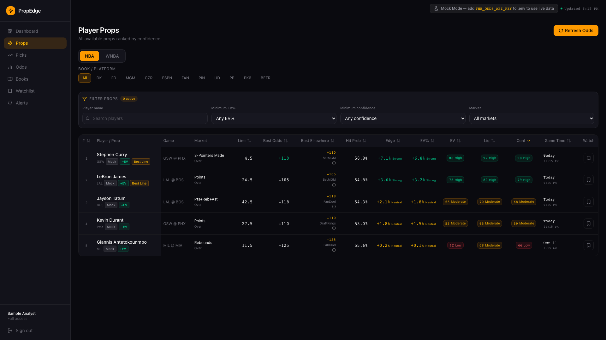
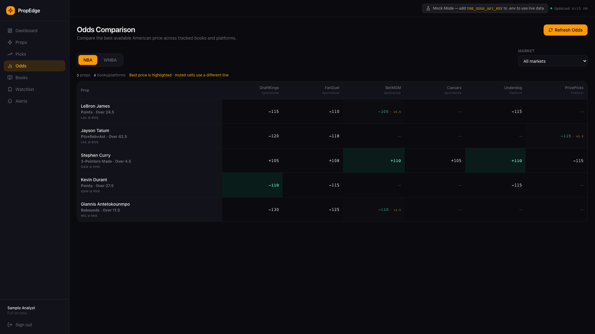

<div align="center">

# PropEdge

**Cross-book player prop analytics for the NBA and WNBA.**

Compare available lines and prices. See how each market estimate was formed, where books disagree, and how much data supports it.

[](https://github.com/realjeffreyau/Sportbook-Prop-Analyzer/actions/workflows/ci.yml)


[Overview](#overview) · [Product tour](#product-tour) · [Scoring](#how-estimates-work) · [Run locally](#run-locally) · [Limits](#product-limits)

<br />



<sub>Dashboard with the bundled mock feed. Example prices and estimates are not live odds.</sub>

</div>

---

## Overview

PropEdge is an invite-only workspace for comparing NBA and WNBA player-prop markets across configured sportsbooks and pick'em platforms. Each row shows the available line and price alongside market coverage, data-quality notes, and the score components behind its rank.

PropEdge is a public portfolio project and reference implementation, not a hosted betting service. It supports deterministic mock data for local evaluation and can optionally connect to a paid odds provider.

It analyzes odds; it does not place bets or submit bet slips. Watchlists, alerts, and account administration are user-managed features backed by PostgreSQL.

> [!IMPORTANT]
> PropEdge is an analytics tool, not financial, investment, or betting advice. Probabilities and value estimates are derived from available market prices. They are not player-performance predictions, guarantees, or recommendations.

## Product tour

The screenshots use PropEdge's bundled demo feed and a synthetic sample account. Prices, lines, percentages, and timestamps are illustrative. No user account data or live provider requests are shown.

### Rank and filter player props

Filter by sport, book, player, market, expected value, and confidence. Open a prop to review its available prices and scoring details.



### Compare prices across books

The odds matrix highlights the best available price and shows when another book lists a different line.



## What it includes

| Area | Included |
|---|---|
| Dashboard and props | Ranked NBA/WNBA props, filters, book selection, detail pages, market coverage, and score explanations. |
| Picks and odds | Ranked best-price view and a cross-book odds matrix. |
| Books | Configured sportsbook and pick'em platform views. |
| Watchlist and alerts | User-owned saved props and rules for supported prop conditions. |
| Invites and administration | Invite-only activation, roles, account listing, and access revoke/restore for administrators. |
| Mock feed | Deterministic bundled props when `THE_ODDS_API_KEY` is empty. This does not bypass account sign-in or database setup. |
| Backtesting | Not implemented. The route explains which historical data would be needed; it does not report simulated performance. |

## How estimates work

PropEdge estimates fair value from sportsbook prices. It is not a player-performance model.

- **Fair probability:** paired Over/Under or Yes/No prices for the same line are de-vigged and combined. When the opposite side or enough sportsbook coverage is missing, the estimate uses a flagged fallback and lowers data quality.
- **Edge and expected value:** the best available price is compared with the market-derived probability. Where coverage permits, a book is excluded from its own benchmark.
- **Confidence:** the composite summarizes the strength and quality of the price signal. It is not the probability that a player will hit a prop.

| Confidence component | Default weight |
|---|---:|
| Expected value | 40% |
| Liquidity | 20% |
| Line-shopping value | 15% |
| Data quality | 25% |

Whale/steam scoring is unavailable and contributes 0%. Scores include quality warnings for stale data, line differences, and limited market coverage.

## Run locally

Requirements: **Node.js 20+**, npm, and a PostgreSQL database. A The Odds API key is optional.

```bash
git clone https://github.com/realjeffreyau/Sportbook-Prop-Analyzer.git
cd Sportbook-Prop-Analyzer
npm ci
cp .env.example .env
```

Set `DATABASE_URL` to your PostgreSQL connection string and generate a local `AUTH_SECRET`. Then prepare the database and start the app:

```bash
npm run db:generate
npm run db:push
npm run db:seed
npm run dev
```

Open the address printed by `npm run dev`. This starts a development server on your machine; it does not create a hosted demo. To seed an administrator, set both `ADMIN_EMAIL` and `ADMIN_PASSWORD` in `.env` before running the seed command. Otherwise, an administrator can invite accounts through the app.

### Data configuration

| Variable | Use |
|---|---|
| `DATABASE_URL` | PostgreSQL connection string for sign-in, invites, user data, and persisted cache/logs. Required for database-backed features. |
| `AUTH_SECRET` | Auth.js session encryption/signing secret. Use a long random value and keep it private. |
| `AUTH_URL` | Optional canonical local or deployed Auth.js URL. Usually omitted for local development. |
| `AUTH_TRUST_HOST` | Optional; use `true` only behind a trusted reverse proxy. |
| `APP_BASE_URL` | Optional locally; required in production to create invite links. |
| `THE_ODDS_API_KEY` | Optional server-side key for live odds. Leave blank for bundled mock data. |
| `ODDS_API_REGION`, `ODDS_API_BOOKMAKERS`, `ODDS_API_DFS_BOOKMAKERS` | Optional provider request settings. Defaults are in `.env.example`. |
| `ADMIN_EMAIL`, `ADMIN_PASSWORD` | Optional seed credentials for an active administrator. |

Keep every secret server-side. Do not use `NEXT_PUBLIC_` for database credentials, auth secrets, invite settings, or provider keys. This app reads `DATABASE_URL`; it does not use a separate `DIRECT_URL` variable.

### Mock and live data

With no `THE_ODDS_API_KEY`, PropEdge serves the bundled mock feed and makes no request to The Odds API. Sign-in, invites, watchlists, alerts, and admin features still require the configured PostgreSQL database.

When a key is configured, loading pages reads the available cache. **Pressing Refresh Odds is a manual action that can spend paid provider credits.** Refresh access is limited to `ADMIN` and `MEMBER_FULL` accounts.

## Development checks

The GitHub Actions workflow runs these checks on pushes and pull requests to `main`:

```bash
npm run typecheck
npm run lint
npm run test
npm run build
```

Useful database commands:

| Command | Purpose |
|---|---|
| `npm run db:generate` | Generate the Prisma client. |
| `npm run db:push` | Apply the Prisma schema to the configured database. |
| `npm run db:seed` | Seed sports, books, defaults, and the optional administrator. |

## Product limits

- PropEdge does not place wagers, submit bet slips, or automate sportsbook actions. See the separate [Bet Placement Roadmap](BetPlacementRoadmap.md).
- Backtesting is not implemented; there are no historical performance or benchmark claims.
- Market-derived estimates describe available prices and coverage. They do not predict player performance or guarantee outcomes.
- Sports betting is legal only in some jurisdictions. Users are responsible for following local law and must be of legal age.

## Deployment and security

For a deployment, set `DATABASE_URL`, `AUTH_SECRET`, and `APP_BASE_URL` in the hosting provider's server-side environment. Configure `AUTH_URL` only when a canonical URL is needed, and set `THE_ODDS_API_KEY` only for live odds. Apply the Prisma schema and seed data from a trusted environment before inviting users; do not run database setup as part of the hosting build.

Before operating a public deployment, review authentication and invite controls, add rate limiting and monitoring, configure HTTPS and server-side secrets, confirm database backups and access policies, and verify that provider data may be displayed under the provider's terms. This is a working reference implementation, not a claim of production compliance or guaranteed data accuracy.

See the [security policy](SECURITY.md) for private vulnerability reporting and secret-handling guidance.

## License

PropEdge is released under the [MIT License](LICENSE). The source repository is [github.com/realjeffreyau/Sportbook-Prop-Analyzer](https://github.com/realjeffreyau/Sportbook-Prop-Analyzer).

## Disclaimer

PropEdge provides market-derived analytics only. Nothing in the app is financial, investment, or betting advice, and no probability, score, edge, expected value, or confidence label promises a result. Gamble only where legal, only if you are of legal age, and responsibly. If gambling is causing harm in the United States, call the National Problem Gambling Helpline at **1-800-522-4700**.
